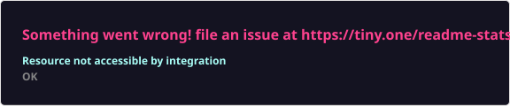

<h1 align="center">Hey, I'm Parvathy M 👋</h1>
<h3 align="center">Aspiring Data Analyst &nbsp;|&nbsp; Data Analytics &nbsp;&amp;&nbsp; Machine Learning</h3>

  
  
  

  
  
  

 

<table width="100%">
<tr>
<td width="60%" valign="top">

### 👩‍🎓 About Me

- 🎓 3rd-year **BCA (Hons.) — AI & Data Science** student at Chinmaya Vishwa Vidyapeeth
- 📍 Based in Thrissur, Kerala, India
- 📊 Focused on **Data Analytics** and **Machine Learning**
- 🔍 Comfortable with data cleaning, EDA, SQL/BigQuery, and building predictive models
- 🚀 Actively looking for an **internship** to apply and grow these skills in a real team
- 🧠 Learning something new about data every week

</td>
<td width="40%" valign="top">

### ⚡ Quick Facts

|  |  |
|---|---|
| 🎯 Focus | Data Analytics · ML |
| 🎓 Year | 3rd Year, BCA (AI & DS) |
| 📍 Location | Thrissur, Kerala |
| 💼 Status | Open to internships |

</td>
</tr>
</table>

 

## 🛠️ Tech Stack

 

 

 

 

## 🏅 Certifications

<table>
<tr><td>🎓</td><td><b>Conversational Data Analysis with LLMs</b> — AICTE–VOIS Virtual Internship</td></tr>
<tr><td>🛰️</td><td><b>Remote Sensing Data Analytics</b> — Indian Space Research Organisation (ISRO)</td></tr>
<tr><td>🤖</td><td><b>Artificial Intelligence Internship</b> — AICTE & Edunet Foundation</td></tr>
<tr><td>🐍</td><td><b>Introduction to Python</b> — IBM Career Education Program</td></tr>
</table>

 

## 📂 Projects

My project work spans data cleaning, exploratory analysis, and machine learning.

> 📌 **See all my work in detail on my [Repositories tab →](https://github.com/ParvathyM155?tab=repositories)**

 

## 📊 GitHub Stats

 

 

## 📬 Connect With Me

<i>💡 Driven by curiosity, fueled by data.</i>

